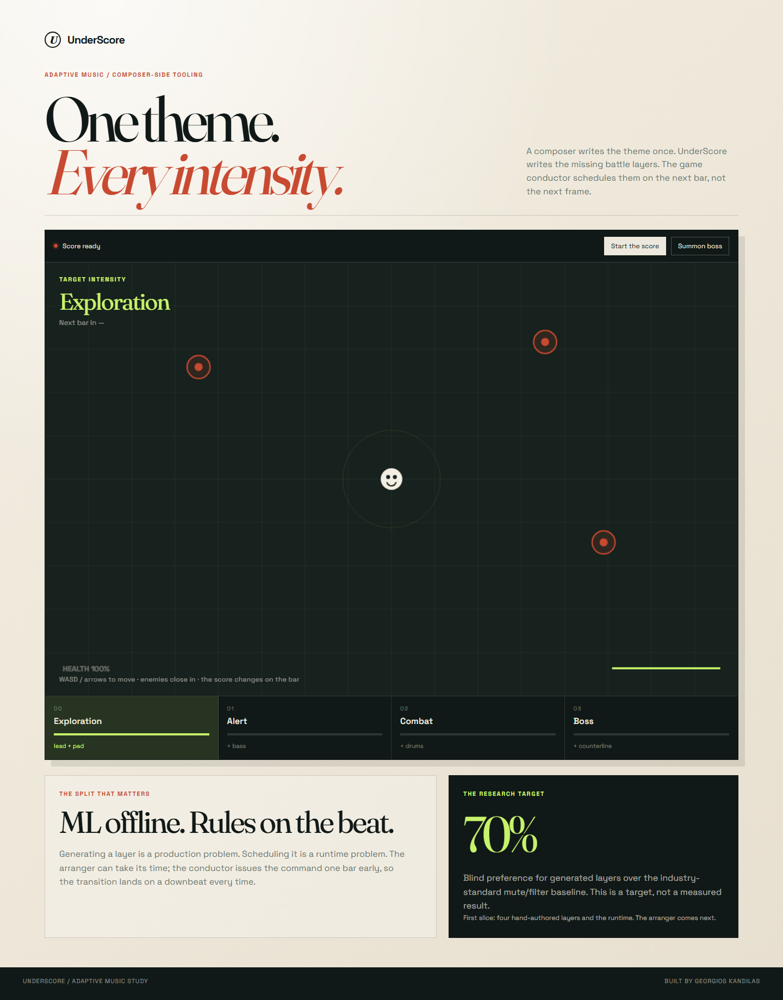

# UnderScore

[](https://github.com/kdngiorgos/underscore-music/actions/workflows/ci.yml)

**One theme. Every intensity.**

[Live demo](https://kdngiorgos.github.io/underscore-music/web/) · [Research](research/RESEARCH.md) · [Architecture](docs/ARCHITECTURE.md)

UnderScore is a composer-side adaptive-music study. A composer writes a theme once; the system produces four synchronized intensity layers and a game-side conductor schedules each transition on the next bar. The model belongs offline in production. The runtime is deliberately rule-based and sample-accurate.



## The thesis

Adaptive game music is not blocked by the runtime. Godot, Wwise and FMOD already provide bar-quantized transitions and crossfades. The expensive part is the **content**: every intensity level is another synchronized cue that must share tempo, key, chords, orchestration and loop length.

The project studies one narrow question:

> Can a small trained symbolic arranger turn a composer's own theme into intensity layers that listeners prefer to the standard mute/filter layering baseline, on themes it has never seen?

The model is the research contribution. The conductor is deterministic by design.

## Current status

**Week 1 vertical slice.** This repository is being built in public.

Working now:

- A 19.2-second, 8-bar original theme at 100 BPM, rendered to four synchronized WAV mixes.
- A deterministic conductor with a one-bar lookahead and four inspectable intensity rules.
- A playable browser scene where enemy pressure and a boss toggle change the requested intensity.
- Exact stem mixing: all four layers start together, so transitions are scheduled on the audio clock, not on a rendering frame.
- Unit tests for the conductor and renderer.
- A public-first research plan with explicit baselines, metrics and limitations.

Not built yet:

- The trained arranger model.
- Slakh/Lakh ingestion and ablation labels.
- A blind listener study.
- The `70%` preference target. It is a target, not a result.
- A measured latency comparison against the mute/filter baseline.

## Run the demo

Prerequisites: `uv` and Python 3.12.

```powershell
uv sync --extra dev
uv run underscore render --output web/stems
uv run pytest
python -m http.server 8766 --directory web
```

Open <http://localhost:8766>, click **Start the score**, move with WASD or the arrow keys, and press **Summon boss**. The requested intensity changes after the next bar boundary.

Re-render the audio after editing the theme:

```powershell
uv run underscore render --output web/stems
```

## Architecture

```text
OFFLINE                                      RUNTIME
theme + target intensity                     game state → rules
        ↓                                          ↓
small symbolic arranger                      one-bar lookahead
        ↓                                          ↓
four loop-locked stems                       deterministic gain ramps
        └────────────── audio bank ────────────────┘
```

The split is intentional: ML can take minutes; the reaction path must be exact.

## The four levels

| Level | Name | Musical role | Game rule |
|---:|---|---|---|
| 0 | Exploration | lead + pad | no immediate threat |
| 1 | Alert | + bass | an enemy is nearby or the player was hit |
| 2 | Combat | + drums | two enemies nearby, or one at low health |
| 3 | Boss | + counterline | boss alive |

These are the project's hand-authored Week 1 layers, not model outputs.

## Why a trained model

A prompted text-to-music model cannot reliably take a specific theme and emit a layer sample-aligned to its bar grid, in its key, over its exact chords, at its loop length. The proposed arranger is a small symbolic transformer with hard grid, key, chord and loop constraints. It will be evaluated against:

1. **B0 — one loop:** what small games actually ship.
2. **B1 — mute/filter layering:** the honest non-ML competitor.
3. **B2 — prompted large model:** a baseline expected to struggle with alignment.

The headline target is blind 2AFC preference over B1, with a confidence interval. The current project has no measured model result.

## Data and licences

- Slakh2100: CC BY 4.0, 2,100 songs, 145 hours of aligned multi-track MIDI/audio.
- Lakh MIDI: CC BY 4.0, symbolic only.
- Avoid FMA for training because its per-track licences are mixed; avoid unclear game-music datasets.
- The demo theme and its four layers are original, deterministic assets owned by this project.
- Future soundfont choice must ship with a verified licence file.

No training data or checkpoints are committed.

## Repository map

- `src/underscore/` — theme, renderer and conductor.
- `web/` — playable static demo and rendered stems.
- `tests/` — conductor and render tests.
- `research/` — independent evidence review and scorecard.
- `docs/` — architecture, evaluation and decisions.

## Built with

UnderScore is an agentic engineering project: direction, decisions and review by Georgios Kandilas; implementation accelerated by coding agents. Every public claim must come from a committed script.

## Licence

Code is MIT. The original theme is owned by the project. Dataset and soundfont terms are documented separately.
